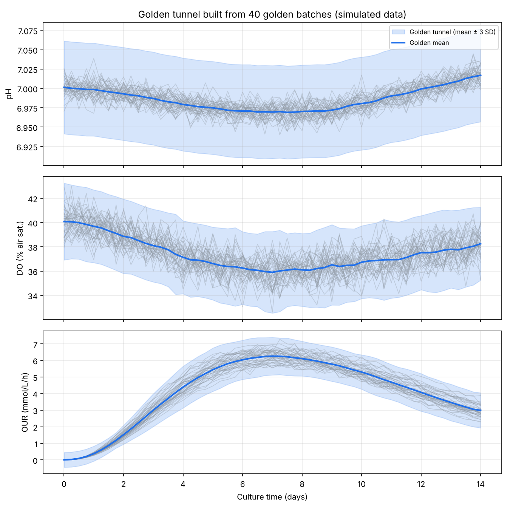
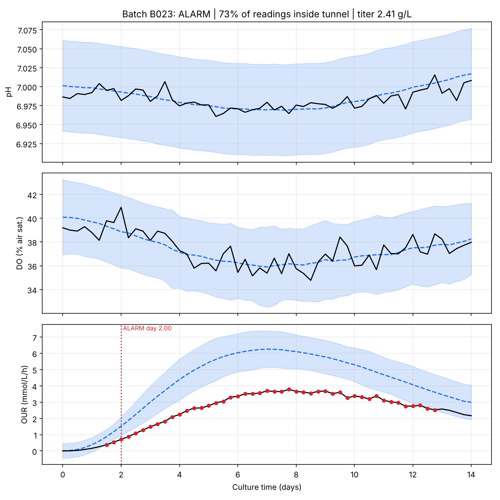
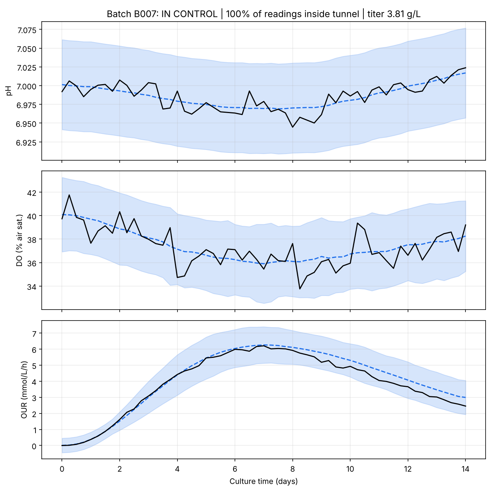

# Golden Tunnel: Batch Monitoring for Biopharma Processes

A Python project that builds a **golden tunnel** (a mean ± k·SD envelope around the best historical batches) for CHO fed-batch bioreactor runs, then uses it to **monitor new batches and raise early alarms** for pH, dissolved oxygen (DO), and oxygen uptake rate (OUR).

> **All data in this repository is simulated.** No real manufacturing data is used or implied. The method is real; the numbers are illustrative.



## What it does

1. **Simulates** 120 CHO fed-batches (14 days) with pH, DO, OUR, final titer, and injected process faults (pH drift, DO excursion, slow growth).
2. **Selects golden batches** from history: top 50% by titer *and* no recorded deviation.
3. **Builds the tunnel**: mean ± k·SD at every time point, with smoothing and a minimum-width floor.
4. **Monitors new batches**: alarms when ≥ 3 consecutive readings leave the tunnel; reports first alarm day, % of readings inside, and z-scores.
5. **Validates** on held-out batches (70% history / 30% new), so the tunnel is never graded on its own training data.

| Alarm on a slow-growth batch (day 2 of 14) | Batch that stayed in control |
|---|---|
|  |  |

## Quick start

```bash
git clone https://github.com/<your-username>/golden-tunnel.git
cd golden-tunnel
python -m venv .venv
source .venv/bin/activate          # Windows: .venv\Scripts\activate
pip install -r requirements.txt
python run_demo.py
```

Options: `--k 2` (tighter tunnel), `--consecutive 5`, `--seed 7`, `--n-batches 200`.
Outputs appear in `data/`, `reports/`, and `figures/`.

Run the tests: `pip install pytest && pytest -q`

## Results (seed 42, k = 3, 36 held-out batches)

Two ways of looking at the same run:

| View | Result |
|---|---|
| **Against process faults** (the simulation's answer key) | All **12/12** faulty batches alarmed; **2/24** healthy batches alarmed |
| **Against final titer** (< 3.5 g/L = "low") | 9 of 10 low-titer batches flagged; 5 alarms on batches that finished in spec |

Reading the second row honestly: 3 of those 5 "extra" alarms were real pH/DO excursions that did not push titer under the limit, so they are useful early warnings rather than errors. The one low-titer batch that was *not* flagged had no process fault, just natural variation, which process curves cannot predict. Median alarm time for caught low-titer batches was **day 2.8 of 14**, leaving time to act.

### The tunnel-width trade-off

On the same data, a tight tunnel (k = 1) alarmed on **100%** of healthy batches, k = 2 on about **29%**, and k = 3 on about **8%**, while faulty batches alarmed at every setting. Choosing k is a sensitivity vs. false-alarm decision. In practice it is justified with DOE/process-characterization data and agreed with Quality.

## Project layout

```
run_demo.py              entry point (runs the whole pipeline)
golden_tunnel/
  simulate.py            simulated CHO fed-batch data
  tunnel.py              golden batch selection + tunnel construction
  monitor.py             alarm logic + performance summary
  plotting.py            charts
tests/                   automated tests
docs/LEARNING_GUIDE.md   bioprocess + coding concepts explained from scratch
docs/PUBLISH_TO_GITHUB.md
```

## Limitations and next steps

- Parameters are monitored **independently** (univariate). A multivariate batch-evolution model (PCA/PLS, Hotelling's T², DModX) would catch unusual *combinations*.
- Assumes **time-aligned** batches of equal length; real data needs phase alignment or Dynamic Time Warping.
- Simulated data only; real deployment needs data from a historian/MES (e.g., DeltaV, PI) and Quality-approved golden batch criteria.
- Ideas: Streamlit dashboard, alert vs. action limits, viable cell density / glucose / lactate, data-driven choice of k.

## License

MIT. See `LICENSE`.
